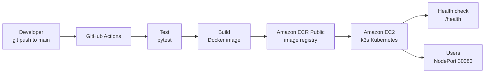

# CI/CD Pipeline for a Flask App on AWS (Docker + Kubernetes)


A small-scale, production-style delivery pipeline. Every push to `main` is tested, packaged as a Docker image, pushed to Amazon ECR and rolled out to a Kubernetes (k3s) cluster running on Amazon EC2, with an automated health check confirming each release.

The application is a Flask dashboard that visualises the delivery pipeline and shows the live state of the Kubernetes pods serving it.

---

## Table of Contents

- [Architecture](#architecture)
- [Tech Stack](#tech-stack)
- [Pipeline Stages](#pipeline-stages)
- [Application Features](#application-features)
- [Project Structure](#project-structure)
- [Run Locally](#run-locally)
- [Deploy to AWS](#deploy-to-aws)
- [Verify the Deployment](#verify-the-deployment)
- [Kubernetes Configuration](#kubernetes-configuration)
- [Security Notes](#security-notes)
- [Limitations and Future Improvements](#limitations-and-future-improvements)
- [Cost and Cleanup](#cost-and-cleanup)
- [Author](#author)

---

## Architecture



**Flow summary:** a push to `main` triggers the workflow. The tests must pass before an image is built. The image is tagged with the commit SHA, pushed to Amazon ECR Public, and deployed to the k3s cluster with a rolling update. The pipeline finishes by confirming the rollout and calling the `/health` endpoint.

## Tech Stack

| Area | Technology |
|---|---|
| Application | Python, Flask, Gunicorn |
| Testing | pytest |
| Containerisation | Docker |
| CI/CD | GitHub Actions |
| Image registry | Amazon ECR Public |
| Compute | Amazon EC2 (Amazon Linux, t3.small) |
| Orchestration | Kubernetes (k3s) |
| Access and security | IAM, Security Groups, GitHub Secrets |

## Pipeline Stages

The workflow is defined in `.github/workflows/deploy.yml` and runs on every push to `main`.

| # | Stage | Description |
|---|---|---|
| 1 | Checkout | Fetches the repository onto the runner |
| 2 | Setup Python | Installs Python 3.11 |
| 3 | **Test** | Installs dependencies and runs `pytest`. A failure stops the pipeline before anything is built or deployed |
| 4 | Configure AWS | Loads AWS credentials from GitHub Secrets |
| 5 | Login to ECR Public | Authenticates Docker with the registry |
| 6 | **Build** | Builds the Docker image, tagged with the commit SHA |
| 7 | **Push** | Pushes the image to Amazon ECR Public |
| 8 | **Deploy** | Copies the Kubernetes manifest to the EC2 host and applies it with `kubectl` (rolling update) |
| 9 | **Verify** | Waits for the rollout to complete and calls `/health`. The run fails if the app is unhealthy |

Tagging images with the commit SHA makes every release traceable and allows a rollback by redeploying an earlier tag.

## Application Features

- **Delivery pipeline view:** an animated illustration of the six stages a change goes through (illustrative, not a live pipeline status).
- **Live cluster view:** one card per Kubernetes pod, discovered from live health checks. Each card shows the pod name, its status, uptime and the number of health checks it answered.
- **Recent events:** a log that records when a pod is detected, stops responding or recovers.
- **Health indicator:** the dashboard polls `/health` every 2 seconds and shows `Healthy` or `Unreachable`.
- **Health endpoint:** `GET /health` returns JSON and is used by the dashboard, the Kubernetes probes and the pipeline.

```json
{ "status": "ok", "pod": "flask-app-6d8f7c9b4d-abcde", "uptime_seconds": 120 }
```

<!--
Add screenshots to a docs/ folder, then remove these comment markers.

## Screenshots


-->

## Project Structure

```
flask-cicd/
├── .github/
│   └── workflows/
│       └── deploy.yml      # CI/CD pipeline
├── k8s/
│   └── app.yaml            # Deployment and Service manifests
├── app.py                  # Flask application and dashboard
├── test_app.py             # pytest tests
├── requirements.txt        # Python dependencies
├── Dockerfile              # Container image definition
└── README.md
```

## Run Locally

**Prerequisites:** Python 3.8 or newer and Git.

```bash
git clone https://github.com/<your-username>/flask-cicd.git
cd flask-cicd
python -m pip install -r requirements.txt
python -m pytest
python -m flask --app app run
```

Open `http://127.0.0.1:5000`. Running locally shows a single pod, because there is only one process.

**Optional, with Docker:**

```bash
docker build -t flask-app .
docker run -p 5000:5000 flask-app
```

## Deploy to AWS

The infrastructure is created once by hand. After that, every deployment is automatic.

### 1. Amazon ECR Public repository

1. In the AWS Console, switch to the **us-east-1** region (required for ECR Public).
2. Open **Elastic Container Registry → Public registry → Repositories → Create repository**.
3. Name it `flask-app` and note the registry alias from the repository URI: `public.ecr.aws/<alias>/flask-app`.
4. Set `IMAGE` in the `env` section of `.github/workflows/deploy.yml` to that URI.

### 2. IAM user for the pipeline

1. Create an IAM user (for example `github-actions`) with permission to push to ECR Public.
2. Create an access key for the user and store the values securely.

### 3. EC2 instance with k3s

1. Launch an EC2 instance: Amazon Linux, `t3.small`, with a new key pair (`.pem`).
2. Security group inbound rules:
   - TCP **22** (SSH), so GitHub Actions can connect
   - TCP **30080**, for the application (NodePort)
3. Connect to the instance and install k3s:

```bash
   curl -sfL https://get.k3s.io | sh -
   sudo k3s kubectl get nodes     # the node should report Ready
```

### 4. GitHub Secrets

Add these under **Settings → Secrets and variables → Actions**:

| Secret | Value |
|---|---|
| `AWS_ACCESS_KEY_ID` | Access key of the IAM user |
| `AWS_SECRET_ACCESS_KEY` | Secret key of the IAM user |
| `EC2_HOST` | Public IPv4 address of the EC2 instance |
| `EC2_SSH_KEY` | Full contents of the `.pem` private key |

### 5. Trigger the pipeline

```bash
git push origin main
```

Open the **Actions** tab to follow the run. When all stages are green, the new version is live.

> If the EC2 instance is stopped and started again, its public IP changes. Update the `EC2_HOST` secret, or attach an Elastic IP.

## Verify the Deployment

Open `http://<EC2_PUBLIC_IP>:30080` in a browser.

On the instance:

```bash
sudo k3s kubectl get pods                    # 2 pods, READY 1/1, Running
curl http://localhost:30080/health           # {"status":"ok", ...}
```

**Self-healing check:** delete a pod and watch Kubernetes replace it.

```bash
sudo k3s kubectl delete $(sudo k3s kubectl get pods -o name | head -1)
sudo k3s kubectl get pods
```

The dashboard stays available because the second replica continues to serve traffic while the replacement starts.

## Kubernetes Configuration

`k8s/app.yaml` defines:

- **Deployment** with 2 replicas, which gives rolling updates and keeps the app available during releases.
- **Readiness probe** on `/health`, so a pod receives traffic only when it is ready.
- **Liveness probe** on `/health`, so a stuck pod is restarted automatically.
- **Service** of type `NodePort` exposing port `30080`.

The image field in the manifest is a placeholder (`IMAGE`). The pipeline replaces it with the freshly built, commit-tagged image before applying the manifest.

## Security Notes

- Credentials are stored as GitHub Secrets and are never committed to the repository.
- The pipeline user should have only the registry permissions it needs.
- SSH (port 22) is open to all addresses because GitHub-hosted runners do not use fixed IP addresses. This is acceptable for a learning project but should be restricted in production.

## Limitations and Future Improvements

This project is a small-scale version of a production delivery pipeline. Differences from a production setup:

| Current setup | Production approach |
|---|---|
| Single EC2 node running k3s | Managed Kubernetes (Amazon EKS) across multiple nodes |
| Long-lived AWS access keys in GitHub Secrets | GitHub OIDC with a short-lived IAM role |
| Public ECR repository | Private ECR repository |
| `kubectl` executed over SSH | Direct cluster access from the pipeline, or a GitOps tool such as Argo CD |
| One environment | Separate staging and production environments |
| Access through `IP:30080` | Domain name with an Ingress or load balancer and HTTPS |
| Manual infrastructure setup | Infrastructure as code (Terraform or CloudFormation) |

Possible next steps: add an Ingress with TLS, move the infrastructure into Terraform, authenticate with OIDC, and add a staging environment with a manual approval step.

## Cost and Cleanup

The EC2 instance incurs charges while it is running. Stop it when it is not needed:

**EC2 → Instances → select the instance → Instance state → Stop instance.**

While the instance is stopped, the deploy stage of the pipeline will fail because the host is unreachable.

## Author

**Anuj Shinde**
